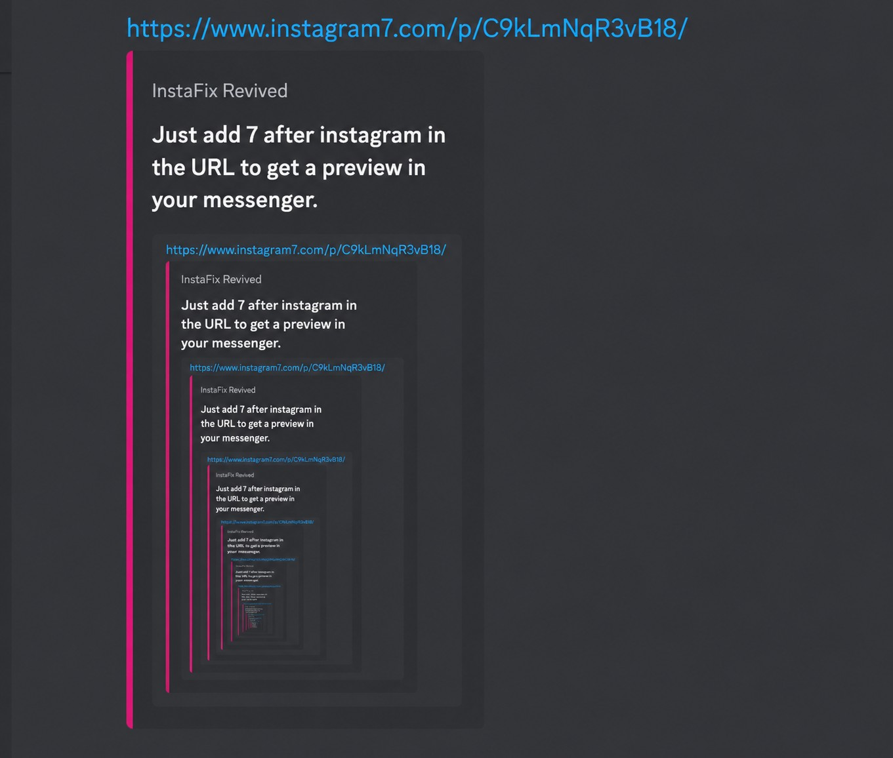

# InstaFix Revived

> Better Instagram previews for chats — public posts, Reels, thumbnails, captions, and playable media when available.

**InstaFix Revived** is a maintained, lightweight continuation of [Wikidepia/InstaFix](https://github.com/Wikidepia/InstaFix). It fixes the boring/broken Instagram embeds you often get in Telegram, Discord, Slack, WhatsApp, and other chat apps by serving cleaner OpenGraph/Twitter-card preview pages.

## A note on domains and trademarks

A public deployment of this project was taken offline after a trademark complaint about its domain name. The source code is still available here.

It's an annoying risk with unofficial tools: a registrar can put a domain on hold while a trademark complaint is being handled, and the whole site can disappear overnight. Being open source or putting a "not affiliated" disclaimer on the page doesn't necessarily protect the domain name itself.

If you're running your own instance, pick a neutral domain name that doesn't use someone else's trademark. Keep a backup of your DNS and deployment settings, too. Paying for a domain doesn't guarantee it'll stay reachable.

## Run your own instance

The hosted demo is currently unavailable. You can deploy InstaFix Revived on a domain you control. Start with [`docker-compose.example.yml`](docker-compose.example.yml) and [`.env.example`](.env.example), then share preview links from your own instance.

## Preview

Use a preview link from your own InstaFix Revived instance to get a cleaner embed in a chat app:

## What it does

- Creates cleaner rich previews for public Instagram posts and Reels.
- Shows author, caption, thumbnail, and media metadata where available.
- Supports image and video preview routes.
- Keeps normal browser media traffic lightweight with direct redirects.
- Includes an optional local auth-helper for difficult/restricted cases.
- Includes an optional public GraphQL proxy pool for anonymous fetches, disabled by default.
- Emits additional image tags for carousel previews where clients support them.
- Includes an optional selective video proxy for preview bots, disabled by default.
- Avoids exposing direct Instagram CDN URLs in the minimal homepage JSON preview API.
- Uses a Telegram-specific oversized-Reel fallback: originals at or below 20 MiB stay direct; larger fresh previews are compacted below Telegram's measured WebPage video boundary.
- Can emit an optional daily Telegram operations report with per-Reel decisions (`direct`, `compact`, `expected image`, `blocked`) and media sizes.

## Telegram Reel previews

Telegram's fresh WebPage video ingestion was measured at an exact **20 MiB** boundary: `20,971,520` bytes is accepted, while `20,971,521` bytes is not attached as the preview video document. InstaFix Revived therefore keeps small originals untouched and, for Telegram only, uses a fast DASH video+audio remux for oversized Reels. The compact path uses stream copy rather than an automatic x264 re-encode.

The investigation also ruled out several misleading causes such as OG tag order, redirects, Cloudflare proxying and simple hostname changes. Older >20 MiB previews can still appear to work when Telegram already has a historical media document cached.

See [Telegram Reel previews: current design and the 20 MiB boundary](docs/telegram-reel-previews.md) for the measured behavior, fallback design, cache notes and monitoring fields.

## Optional Cloudflare edge

InstaFix does not require a Cloudflare Worker. A normal Caddy/Nginx/reverse-proxy deployment is enough. Self-hosters who want an edge layer similar in purpose to the public instance can start from the generic [Cloudflare Worker example](examples/cloudflare-worker/README.md). It contains no production-specific routes, diagnostics, account IDs, or secrets.

## Why this exists

Instagram links often preview poorly outside Instagram. Sometimes the caption is missing, sometimes Reels do not play, and sometimes the preview is just ugly or incomplete.

InstaFix Revived sits between the chat app and Instagram, reads public metadata, and returns a small preview page with friendlier embed tags.

## Support the project

If you self-host this project or find the code useful, a star on GitHub helps a lot.

You can also support the maintainer here:

- GitHub: [@Bl0ck154](https://github.com/Bl0ck154)
- GitHub Sponsors: [github.com/sponsors/Bl0ck154](https://github.com/sponsors/Bl0ck154)
- Buy Me a Coffee: [buymeacoffee.com/bl0ck](https://buymeacoffee.com/bl0ck)
- PayPal: [paypal.me/IlliaZabolotskyi](https://paypal.me/IlliaZabolotskyi)

## Attribution

Maintained by [Bl0ck154](https://github.com/Bl0ck154).

Derived from and inspired by [Wikidepia/InstaFix](https://github.com/Wikidepia/InstaFix).

Instagram is a trademark of Instagram, Inc. This project is independent and is not affiliated with Instagram, Meta, or Instagram, Inc.
